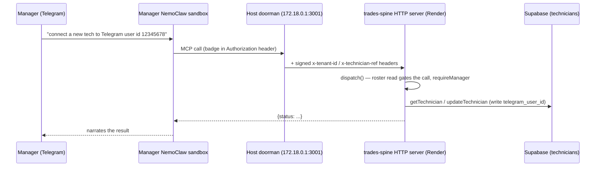

## Summary

Today, connecting a new technician's phone to the system is a **hand-carried, operator-only** act.
A "NemoClaw" is one AI-agent sandbox (an isolated container running the OpenClaw runtime) that
talks to the technician over a Telegram bot. Each bot is locked to exactly one person by a
**sender allowlist** — the technician's Telegram **user id** (a numeric account id, e.g. obtained
from `@userinfobot`). That binding is set **once, at sandbox build time**, during the interactive
`nemoclaw onboard` wizard on the host box (Box_Setup_Stuff/doorman-nemoclaw-setup-guide.md §4).
So the current flow is: manager gets the technician's Telegram user id → sends it to us (the
operators) → an operator types it into `nemoclaw onboard` on the box. There is **no server-side
field for a Telegram user id, no control-plane channel that carries it to the host, and no
manager-facing tool that requests a binding**. This research maps every piece that would have to
change for the manager to instead say, in their manager-tier Telegram chat, "connect a new
technician to this Telegram user id" and have it happen end to end.

The system already has the exact shape this feature needs, one layer over: the **badge-pull
channel**. The server's `technicians` roster row drives a host that polls `GET /control/badges`
every 5 minutes; the pull response ships a badges file and mints new badge secrets into a host
pending file for an operator to install. A Telegram binding is the *same kind of directive* — a
per-person value the server knows and the host must apply to a sandbox — but that directive
carrier does not exist yet for Telegram; only badges ride it, and even badges still need a manual
host-side install step (a human runs `openshell provider update`). The two open questions the
prior cold-sandbox research (2026-07-03) flagged are still open and are the crux of this feature:
**(1)** can a sandbox's sender allowlist be re-bound on an *already-built, running* sandbox without
a rebuild (the "late re-bind" experiment, still `PENDING`), and **(2)** the cold-pool
auto-allocator (server claims the next free sandbox for a new hire) — without which an operator
stays in the loop no matter what the manager tool does.

## Entry Points

Where the "manager asks their NemoClaw to connect a technician" flow would begin and where the
Telegram binding physically lives today:

- **Manager tool surface** — `src/mcp/server.ts:163` (`ADMIN_TOOLS` array). The manager-tier tools
  (`add_technician_seat`, `get_connect_link`, etc.) are defined here; a new "bind Telegram" tool
  would be added to this array and dispatched in the `switch` at `src/mcp/server.ts:310`. Manager
  gating is at `src/mcp/server.ts:306` (`ADMIN_TOOL_NAMES` check) and `src/mcp/server.ts:277`
  (`isActiveManager`).
- **The roster row** — `supabase/migrations/20260702194603_technicians_and_review_items.sql:8`
  (`technicians` table). This is where a `telegram_user_id` column would go. Prior research
  (2026-07-03 cold-sandbox, line 61) already names this as the expected home.
- **Badge-pull server endpoint** — `src/mcp/httpServer.ts:119` (`handleBadgePull`) →
  `src/control/badgeFile.ts:33` (`buildBadgeResponse`). The natural carrier for a binding directive
  alongside badge state.
- **Badge-pull host script** — `Box_Setup_Stuff/badge-pull.sh` (runs as root on a 5-min systemd
  timer). Where a host-side "apply the Telegram binding" step would attach.
- **The actual Telegram binding today** — set interactively at
  `Box_Setup_Stuff/doorman-nemoclaw-setup-guide.md:296` (`nemoclaw onboard` "messaging channel"
  prompt: paste bot token + user ID) and `Box_Setup_Stuff/bootstrap-box.sh:124`
  (`phase_onboard_help`, "messaging channel Telegram — paste bot token + your user ID"). This is
  **the only documented binding point** and it is build-time and operator-only.

## Key Files

### Server: MCP tool surface (where a new manager tool lands)
- `src/mcp/server.ts` — the single MCP boundary the agent calls. Defines `TOOLS` (7 technician
  tools, `:72`) and `ADMIN_TOOLS` (7 manager tools, `:163`). `dispatch()` (`:282`) runs one roster
  read that gates every call (`:299`), then re-gates admin tools by name (`:306`). Every admin tool
  looks up its target with `getTechnician(tenantId, ref)` and validates state before acting. A
  "bind Telegram" tool would follow the exact `get_connect_link` shape (`:603`): take a `ref`,
  fetch the row, validate state, write a field, return a status. Notable existing patterns it would
  reuse: two-step confirm via `review_items` (deactivate, `:458`), CAS state writes
  (`casTechnician`), and returning a `status` string the agent narrates to the manager.
- `src/mcp/httpServer.ts` — the central stateless HTTP server. Routes `/control/badges` (`:147`) to
  `handleBadgePull` and MCP calls to a per-request identity-scoped `createServer`. A new
  control-plane endpoint (or an extension of the badge pull) for Telegram bindings would attach in
  `handle()` (`:139`).
- `src/mcp/identity.ts` — resolves `{tenantId, technicianRef}` from the gateway's signed headers
  (not read here in full, but referenced at `server.ts:45`). The caller's identity is never taken
  from tool args.

### Server: the roster + review queue (data model)
- `src/db/technicians.ts` — the typed DB layer for the roster. `TechnicianPatch` (`:93`) is the
  explicit allowlist of control-plane-settable fields; a `telegram_user_id` field would be added
  here. `getTechnician` (`:18`), `updateTechnician` (`:105`), `casTechnician` (`:131`, compare-and-
  swap state transition), `claimBadgeHash` (`:155`, write-if-null mint claim — the pattern a
  binding-claim would mirror), `listTechniciansForHost` (`:65`, the badge-pull working set),
  `isInactiveState` (`:197`).
- `src/db/reviewItems.ts` — the tenant-scoped manager review/confirmation queue. `ReviewKind`
  (`:10`) is a plain-string union (new kinds need no migration). `upsertOpenReviewItem` /
  `resolveReviewItem` back the two-step confirm and pairing-verification flows; a Telegram binding
  that needs manager confirmation, or a "binding applied on host" acknowledgement, could ride this
  same queue.
- `src/db/hosts.ts` — `hosts` registry; `getHostByTokenHash` (`:21`) authenticates the badge pull.
- `supabase/migrations/20260702194603_technicians_and_review_items.sql` — creates `technicians`
  (`:8`), the `technician_state` enum (`:5`: invited → pending_verification → active → offboarding
  → offboarded), the seat-cap trigger (`:38`), and `review_items` (`:56`).
- `supabase/migrations/20260703010056_control_plane_lifecycle.sql` — adds `hosts`, `badge_hash`,
  `host_id`, `offboarding_started_at`, `link_issued_at` to `technicians`. A new migration adding
  `telegram_user_id` would sit alongside these.

### Server: badge/directive plumbing (the carrier to extend)
- `src/control/badges.ts` — `mintBadge()` (`:18`) and `sha256hex` (`:9`). Badges are 256-bit bearer
  tokens; only the sha256 fingerprint is stored/shipped.
- `src/control/badgeFile.ts` — `buildBadgeResponse(hostId)` (`:33`) builds the per-host pull
  payload: `badgesFile` (fingerprint → `{tenantId, technicianRef, revoked}`) and `newBadges`
  (plaintext minted this pull). This is the object a Telegram-binding directive would be added to
  (e.g. a `bindings` array keyed by `sandboxRef` → `telegramUserId`), OR a sibling endpoint.

### Operator scripts (the human step to be removed)
- `scripts/assign-host.mjs` — operator CLI: `create-host`, `assign ref=… host=… sandbox=…`,
  `set-badge`, `rotate-badge`. **This is the operator step the feature aims to eliminate for
  binding** (and, per the cold-pool decision point, potentially for host/sandbox assignment too).
  Note its hard guard (`:36`): it refuses to run unless `SUPABASE_URL` targets the hosted test ref.

### Host side (where a binding must physically be applied)
- `Box_Setup_Stuff/badge-pull.sh` — root, 5-min timer. Fetches the pull, atomically replaces
  `badges.json`, appends `newBadges` to `/root/pending-badges.jsonl` for manual install. A Telegram
  binding directive would extend this script (new section to apply the sender allowlist to the
  named sandbox).
- `Box_Setup_Stuff/doorman-nemoclaw-setup-guide.md` — the authority for the box. §4 (`:296`) is the
  onboard wizard where the Telegram bot token + user id are pasted today.
- `Box_Setup_Stuff/bootstrap-box.sh` — scripts the mechanical phases. `phase_wire` (`:290`) does
  egress policy + badge install; a binding step would attach near here. The Telegram binding
  itself is still in the manual `nemoclaw onboard` interlude (`:113` `phase_onboard_help`).
- `Box_Setup_Stuff/doorman-architecture-memory.md` — the portable mental model. §"Naming
  convention": `<AGENT>` = sandbox name; `<AGENT>-telegram-bridge` = the OpenShell **provider**
  that holds the channel (bot token) + badge credentials. The sender allowlist and bot token live
  in this provider store / the sandbox's `openclaw.json` channel config (exact location is one of
  the open questions).

### Prior research/decisions (read these before planning)
- `thoughts/shared/research/2026-07-03-cold-sandbox-identity-injection.md` — **the direct
  predecessor.** Ingredient 2 (`:32`) is exactly this feature's mechanism; the late-re-bind host
  experiment is still `PENDING` (`:88`). Its "Decision points for the RPI" (`:66`) enumerate most
  of the forks below.
- `thoughts/shared/research/2026-07-02-self-serve-onboarding-technicians-table-surface.md` — the
  roster-surface research.
- `docs/control-plane.md` — the lifecycle at a glance (invited → active → offboarded), the Render
  cron heartbeat, badge rollout.
- `docs/nemoclaw-tech-agent.md` §1 (`:26`) — "Restrict the bot to the technician's sender id
  (per-user allowlist)"; §4 (`:90`) — the manager profile's 14-tool surface.

## Data Flows

### Flow as it exists today (Telegram binding = fully manual, build-time)

```
Manager (Telegram chat with manager NemoClaw)
   │  gets technician's Telegram user id (e.g. @userinfobot)
   ▼
Manager → operators (out-of-band: message/email)   ← THE MANUAL HANDOFF THIS FEATURE REMOVES
   │  "connect a tech to Telegram user id 12345678"
   ▼
Operator on the host box
   │  nemoclaw onboard  →  messaging channel prompt: paste bot token + user id
   │  (sandbox BUILD time; the sender allowlist is frozen into the new sandbox)
   ▼
Per-technician NemoClaw sandbox, bot bound to that one Telegram user id
```

Separately, the badge (spine-access credential) flows automatically server→host, but even it needs
a manual host-side install:

```
Server: technicians roster row (assigned host_id + sandbox_ref via assign-host.mjs)
   │
   ▼  host polls every 5 min:  GET /control/badges  (buildBadgeResponse)
   │
Response: { badgesFile:{fingerprint→{tenant,ref,revoked}}, newBadges:[{ref,sandboxRef,badge}] }
   │
Host badge-pull.sh: writes badges.json (automatic) + appends newBadges to pending file
   │
   ▼  OPERATOR:  openshell provider update <AGENT>-telegram-bridge --credential TRADES_SPINE_BADGE=…
Sandbox holds the badge → can call the spine through the doorman
```

### How the manager tool call reaches the server (the request path, unchanged)



The **manager-tool half of this feature is well-trodden**: it is a new entry in `ADMIN_TOOLS`
(`server.ts:163`) plus a `switch` case (`server.ts:310`) that validates a manager, looks up the
target technician by `ref`, and writes `telegram_user_id`. Every guard it needs already exists
(manager gate `:306`, tenant scoping, CAS writes, review-item confirmations). What does **not**
exist is the second half: getting that value from the server to the host and *applying* it to a
sandbox's sender allowlist — and doing so without an operator and without a rebuild.

### The gap: server value → host → sandbox sender allowlist

There is currently **no path at all** for a per-person Telegram user id to travel server→host. The
badge-pull response (`buildBadgeResponse`, `badgeFile.ts:33`) carries only badge state. The
host-side `badge-pull.sh` knows how to apply exactly one kind of directive (badges). The sender
allowlist itself lives inside the OpenShell provider `<AGENT>-telegram-bridge` / the sandbox's
`openclaw.json` messaging-channel config — and **whether it can be changed on a running sandbox is
unverified** (the 2026-07-03 experiment is still `PENDING`).

## External Dependencies

- **OpenShell / OpenClaw / NemoClaw** (NVIDIA) — the sandbox runtime and its gateway. The Telegram
  channel (bot token + sender allowlist) is configured through `nemoclaw onboard` and the
  `openshell provider` store. Whether a late sender-allowlist re-bind is a config edit + hash
  recompute, a provider write, or a channel re-onboard is the central unknown. **Per CLAUDE.md
  ("External services — verify against live docs first"), the re-bind mechanism must be confirmed
  against OpenShell/NemoClaw's current docs (or the pending host experiment) before it is designed
  in — not from these repo notes alone.**
- **Telegram (BotFather)** — bot tokens; the sender user id is a numeric Telegram account id and is
  **not a secret** (obtainable via `@userinfobot`); the binding is the access-control act
  (cold-sandbox research `:45`). Each sandbox needs its **own** bot token (per-seat), minted today
  manually at onboard.
- **Supabase** — the `technicians` roster (the single source of truth for tier/state and where a
  `telegram_user_id` would live). Tests run only against the local stack (CLAUDE.md); the hosted
  "test" project is the pilot's LIVE DB.
- **Render** — hosts the HTTP server (`/control/badges`) and the lifecycle cron.

## Constraints and Invariants

- **The Telegram chat is the ONLY user-facing surface** (memory: telegram-only-surface;
  cold-sandbox research `:82`). Onboarding must run end-to-end from the manager's chat; operators
  appear only at initial box setup and breakage. A design that still routes the manager through an
  operator does not satisfy the feature.
- **Identity is never taken from tool args** (`server.ts:52`). The caller's `(tenant, technicianRef)`
  comes from the gateway's signed header; a manager tool addresses a *target* technician by `ref`,
  and the server tenant-scopes every lookup.
- **Manager tier is decided server-side by an ACTIVE `tier='manager'` roster row**, not by the
  badge (`server.ts:277`, doorman-architecture-memory `:91`). A "bind Telegram" tool is admin and
  must be gated the same way (add to `ADMIN_TOOL_NAMES`).
- **The badge-pull channel is the established server→host directive carrier, and it is
  wipe-and-replace + fail-closed.** `badge-pull.sh` replaces `badges.json` wholesale from the
  server's view; the empty-roster guard (`:81`) refuses a 0-entry response over a non-empty file
  (post-incident hardening). Any binding directive added to this channel inherits the same
  "server is authoritative, host reconciles" model and must not regress that guard.
- **Refs are unique per tenant across ALL rows and never reused** (technicians migration `:21`).
  A Telegram user id is a per-person attribute; binding it to a `ref` is safe, but note a Telegram
  user id could in principle be re-used across humans over time (person leaves, number reassigned)
  — no uniqueness constraint on `telegram_user_id` exists or is implied today.
- **The sender allowlist is set at sandbox BUILD time today** (`onboard` §4). The cold-pool model
  says sandboxes are pre-built cold and identity-empty and hiring *injects* identity — which is in
  tension with a build-time-only binding. Reconciling this is exactly Ingredient 2 of the
  cold-sandbox research and is unproven (`:43`).
- **A provider credential VALUE swap needs no openclaw restart; the first-ever registration does**
  (cold-sandbox research `:26`, doorman-architecture-memory `:201`). If a late Telegram re-bind
  turns out to be a provider write, the versioning-trap self-heal (bake-in edit 3b) is the relevant
  prior fix to keep in mind.
- **L1 append-only / classify-before-write** invariants (CLAUDE.md) are not directly touched by
  this feature — it is a control-plane/binding change, not a capture-path change.

## Decision Points

These are the forks the current code creates for this feature. No recommendations — just the
options and what each would involve given how the code works today.

1. **Where the manager supplies the Telegram user id, and whether the tool is one step or two.**
   - Option A — extend `add_technician_seat` (`server.ts:408`) to accept an optional
     `telegramUserId` at add time (bind at hire). Smallest tool surface; but the manager may not
     have the user id yet when adding the seat.
   - Option B — a new standalone `bind_telegram` admin tool (mirrors `get_connect_link`, `:603`):
     take `ref` + `telegramUserId`, write the column, return a status. Lets the id arrive later.
   - Either way: a two-step confirm (like deactivate, `:458`) via `review_items` is available if
     the binding should be manager-confirmed, but a Telegram user id is low-stakes (not a secret),
     so a one-shot write is also defensible.

2. **How the binding travels server → host: extend the badge pull vs a separate endpoint.**
   - Option A — add a `bindings` field to `buildBadgeResponse` (`badgeFile.ts:33`), keyed by
     `sandboxRef` → `telegramUserId`, and teach `badge-pull.sh` to apply it. Reuses the existing
     authenticated 5-min channel and the "server authoritative, host reconciles" model; keeps one
     carrier. Must not regress the empty-roster fail-closed guard.
   - Option B — a new `GET /control/bindings` endpoint (sibling of `/control/badges` in
     `httpServer.ts:147`) with its own host-side puller. Cleaner separation; more moving parts.

3. **What "apply the binding on the host" actually is — and whether it needs an operator (THE
   BLOCKING UNKNOWN).** The 2026-07-03 late-re-bind experiment is still `PENDING` (cold-sandbox
   research `:88`). The answer determines everything downstream:
   - If a running sandbox's sender allowlist **can** be re-bound (config edit + hash recompute, or a
     provider write) → the host puller can apply it automatically, no operator, no rebuild — the
     feature is fully achievable. This must be **verified against OpenShell/NemoClaw docs or the
     host experiment first** (CLAUDE.md external-services rule).
   - If it **cannot** (binding is build-time-only) → applying a binding means a sandbox rebuild or
     re-onboard, which is an operator/interactive step today — the manager tool would only *record*
     the intent and stage it, not complete it. That would not meet the "no operator" goal without
     also solving rebuild automation.

4. **Cold-pool sandbox auto-allocation (required for a genuinely operator-free hire).** Person →
   host/sandbox assignment is today the deliberately operator-side `assign-host.mjs assign`
   (`scripts/assign-host.mjs:90`). For the manager to "connect a *new* technician" with no operator,
   the server must claim the next free cold sandbox on the tenant's host when the seat is added
   (cold-sandbox research decision point 6, `:76`). Options: (a) auto-allocate at
   `add_technician_seat` time; (b) a separate allocation step; (c) leave assignment operator-side
   and scope this feature to *binding only* on an already-assigned sandbox. Without (a) or (b), an
   operator remains in every hire regardless of the binding tool.

5. **Bot-token provenance (per-seat).** Each sandbox needs its own Telegram bot token; today these
   are minted manually at onboard (cold-sandbox research decision point 4, `:74`). If sandboxes are
   pre-built cold with a bot token already installed, binding is just the sender allowlist. If not,
   the token is a second per-hire artifact to mint/inject. This feature's scope depends on whether
   pre-built cold sandboxes already carry a token.

6. **Whether the binding is cleared/re-bound across the lifecycle.** Deactivation today leaves the
   Telegram binding untouched (cold-sandbox research Ingredient 3, `:47`: the agent keeps answering
   its bound sender, just fails closed on spine tools). If this feature adds a set-binding path,
   the symmetric unbind-at-offboarding question (rides deactivate vs expiry; reversible on
   reactivate) becomes live — decision point 5 of the cold-sandbox research (`:76`).

7. **Column shape + validation.** A `telegram_user_id` column on `technicians` (nullable text or
   bigint). Telegram user ids are numeric; validation would reject non-numeric input in the tool.
   No uniqueness is enforced today; whether to add `unique(tenant_id, telegram_user_id)` (to stop
   two techs sharing one phone binding) is a fork — the `TechnicianPatch` allowlist
   (`technicians.ts:93`) and `database.types.ts` regenerate accordingly.

## Open Questions

1. **Can a running sandbox's Telegram sender allowlist be re-bound without a rebuild, and where does
   that binding physically live** (OpenShell provider store / `openclaw.json` channel config /
   gateway config)? This is the 2026-07-03 host experiment, result still `PENDING` (cold-sandbox
   research `:88`). It is the single fact that decides whether this feature can be operator-free.
   Must be resolved by the host experiment and/or live OpenShell docs — not from repo notes.
2. **Do pre-built cold sandboxes already carry a per-seat Telegram bot token**, or is the token a
   second per-hire artifact? (Decision point 5.) Unanswerable from the repo — the cold-pool
   pre-build procedure is operator/host knowledge, not in code here.
3. **Is there an OpenShell/NemoClaw command or API to set a sender allowlist on an existing
   sandbox** (analogous to `openshell provider update` for a credential value swap)? If yes, the
   host-side application is a value swap (no restart); if it requires a rebuild/re-onboard, an
   operator step remains. Verify against live docs.
4. **How does the host know which sandbox belongs to which `ref`** for applying a binding? The
   roster row carries `sandbox_ref` (`technicians` migration `:15`), and the badge pull already
   ships `sandboxRef` in `newBadges` (`badgeFile.ts:63`), so the mapping exists — but the
   host-side puller does not yet act on it for anything but badge install. Confirm the sandbox_ref
   ↔ `<AGENT>` naming is byte-identical to what `openshell`/`nemoclaw` expect.
5. **Does the pilot's live box have exactly one manager sandbox today**, and is that manager's
   NemoClaw already wired with the 14-tool manager surface, so a new admin tool would actually be
   reachable there? (memory notes s1 is the deployed sandbox; the manager-tier live wiring status
   is a deferred verification item.)

## Assumptions (made because this is a non-interactive research run)

- **Scope is research only** (per `research.md`): this document describes the codebase as it exists
  and makes the decision forks visible; it proposes no implementation and edits no source.
- I assumed the feature's "connect a new technician NemoClaw to a Telegram user id" means binding
  the **sender allowlist** (per-user access control) — not merely storing a contact number —
  because the sender allowlist is the documented access-control act (`docs/nemoclaw-tech-agent.md`
  §1, cold-sandbox research Ingredient 2). If the intended meaning is narrower (just record the id
  server-side for later manual use), decision points 3–6 shrink to just the manager tool + column.
- I did **not** run the pending host re-bind experiment or contact any external service (I am
  read-only and non-interactive); its outcome is carried forward as the blocking open question, as
  the prior research left it.
- I treated the hosted "test" Supabase project as the pilot's live DB and did not query or write to
  any database (CLAUDE.md / memory).
