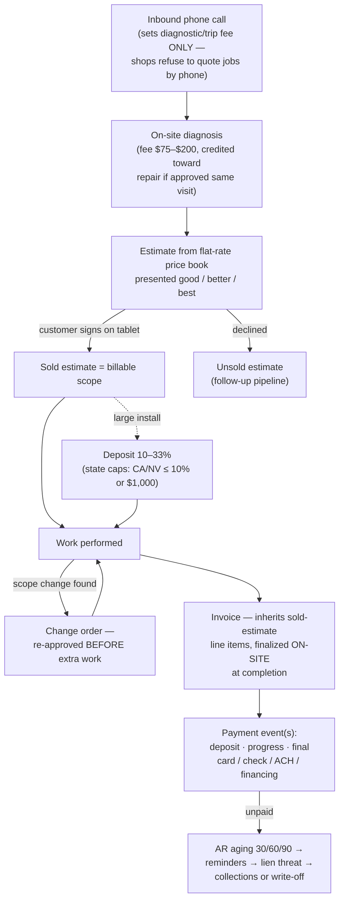

> ## ⚠ Addendum — 2026-08-15, same day (user decision)
> **Design principle ratified immediately after this research was written: the money layer must
> be workflow-agnostic — flexible enough to represent *most* pricing/invoice/payment chains,
> never fitted to a specific pilot firm or to an assumed canonical flow.** Firms differ; our job
> is a representation that absorbs the differences, not a bet on one of them.
>
> Consequences for reading this doc:
> - **Open Questions 1–4 are re-scoped.** They read "ask the pilot firm" — under the ratified
>   principle, pilot answers are *validation data points*, not design inputs. The design target
>   is the variability documented in Part 1 (§1.2–1.8) itself.
> - **Decision fork 1 narrows.** A single mutable number (`jobs.price_cents`) cannot represent
>   divergent chains; flexibility points toward event-shaped structure with money state *derived*
>   by folding events — the house pattern already used by `schedule_events` and the retraction
>   fold.
> - **A conflict becomes visible.** The linear `job_status` tail (`completed → invoiced → paid`)
>   hard-codes exactly one chain: one invoice, issued after completion, paid once. Deposits,
>   progress billing, invoice-at-booking (ServiceTitan semantics), and consolidated commercial
>   billing all violate that ordering. A workflow-agnostic design has to treat the *work*
>   dimension and the *money* dimension as separate, with any money milestones on the job row
>   derived rather than enforced.

## Summary

This researches the last unbuilt stretch of a job's life: what happens after the work, when money
changes hands. Part 1 is external domain research (how real US trades shops — plumbing, HVAC,
electrical, 1–15 people — handle pricing, invoicing, payment, and collections), every load-bearing
claim cited. Part 2 maps that world onto this codebase as it exists today.

Two headline findings.

**Domain:** a job's price is not a number — it is a *lifecycle of evidence-linked events*. The
industry-standard chain is: phone call sets only a diagnostic/trip fee → on-site diagnosis →
estimate built from a **flat-rate price book** (often presented as good/better/best options) →
customer approves with a signature → scope changes go through **change orders** (re-approved before
the extra work starts) → invoice inherits the sold estimate's line items (finalized on-site at
completion, best practice) → payment arrives as one or *several* events (deposit, progress
payments, final; by card/check/ACH/financing) → unpaid invoices age through reminder cadences
toward lien threats, collections, or write-off. Field-service platforms model exactly this chain as
first-class objects: Jobber's API is literally `Quote → Job → Invoice → PaymentRecord`, and in
ServiceTitan the invoice object exists *from the moment the job is booked* and merely accumulates
and finalizes. This event-chain shape is strikingly congruent with the spine's own design
(append-only evidence, structured fields linked to the capture that produced them).

**Codebase:** the spine was *born* with money slots that have never been written. `jobs.price_cents`
has existed since the first migration with zero production writers; the hardcoded job state machine
already ends `completed → invoiced → paid` (with a day-one comment that "the authoritative 'done' is
a downstream event (invoice paid)"); and the capture-channel enum reserves `quote`, `sales_note`,
and `accounting_event` — all verified producer-less. The deeper gap is *upstream* of money: **no
production code path ever writes `completed`** (the only route is a model-extracted `statusSignal`
on a job that some earlier note already moved to `in_progress`), `assignments.status='completed'`
is declared but never written, and `visits.started_at`/`completed_at` are always NULL. The job
lifecycle dead-ends before an invoice could even be triggered. Money stated in conversation lands
today as free-form L3 attributes with model-chosen keys (observed: `attributes.chargeAmount: 400`)
— explicitly unusable for deterministic math, which the repo's own hardcode-vs-AI rule assigns to
code, never the model.

## Part 1 — Domain: how trades shops actually handle money

Compiled 2026-08-15 from vendor documentation, FSM developer APIs, and payment-industry sources.
Vendor-published statistics are flagged where self-interested or thin.

### 1.1 The money lifecycle at a glance



### 1.2 Pricing models

- **Flat rate vs time-and-materials (T&M).** Flat rate = one fixed all-inclusive price for a
  defined repair, approved before work begins ([BuildOps](https://buildops.com/resources/hvac-flat-rate-pricing)).
  T&M = actual hours × rate + materials, total known only at the end
  ([ServiceTitan](https://www.servicetitan.com/blog/flat-rate-vs-hourly)). Residential service/repair
  has largely moved to flat rate; T&M persists where scope is unknowable (hidden-condition work) and
  in commercial/construction; many shops run both
  ([Goodin Co.](https://www.goodinco.com/resources/news/the-source/2025/09/29/which-pricing-structure-is-best-for-small-service-businesses-flat-rate-or-time-and-materials)).
  Service Fusion claims 92% of homeowners prefer flat rate — *no underlying survey cited, directional only*
  ([Service Fusion](https://www.servicefusion.com/blog/flat-rate-or-time-materials-which-pricing-should-you-use)).
- **Price books.** A flat-rate price book catalogs every service with a pre-computed price (parts +
  labor-hours × loaded rate + overhead + margin). Software (ServiceTitan Pricebook, Housecall Pro
  flat-rate tooling) auto-reprices the book when costs change; the tech quotes from a tablet so
  every tech quotes identically ([Housecall Pro](https://www.housecallpro.com/industries/hvac-software/flat-rate-pricing/),
  [ServiceTitan](https://www.servicetitan.com/industries/hvac-software/flat-rate)).
- **Diagnostic/trip fees.** Near-universal for service calls; sources cluster $75–$200 residential
  (modal ~$89–$159 depending who you ask — *sources disagree; big regional variance*)
  ([Pick Comfort](https://www.pickcomfort.com/hvac-call-cost-typical-prices-components-savings/),
  [Pricebookr](https://www.pricebookr.com/blog/should-you-charge-a-diagnostic-fee)). After-hours
  1.5–2× ([Smart Service](https://www.smartservice.com/blog/trip-charge-minimum-fee)). Convention:
  **the fee is credited toward the repair if approved same-visit**
  ([ServiceTitan](https://www.servicetitan.com/blog/hvac-diagnostic-fee)).
- **The phone call does not set the job price.** Shops deliberately refuse phone quotes (too many
  unknowns; a wrong ballpark destroys trust) — the call sets the diagnostic fee; the price comes
  after on-site diagnosis, from the book, before work starts
  ([John C. Flood](https://www.johncflood.com/our-blog/why-cant-you-give-me-a-quote-over-the-phone-for-an-hvac-job/),
  [Donnelly's](https://www.4donnellys.com/blog/why-we-cant-give-out-ballpark-hvac-price-estimates-over-the-phone/)).
  Replacements/installs get a free in-home estimate instead of a paid diagnostic
  ([Wright AC](https://www.wrightac.com/blog/why-you-typically-cant-get-an-hvac-replacement-quote-over-the-phone/)).

### 1.3 How the price legitimately changes through a job

- **Canonical flow:** diagnose → build estimate from price-book items → present options → customer
  approves (tablet signature / e-approval) → estimate becomes billable scope → invoice inherits its
  line items. In ServiceTitan this is literal data flow: estimate status flips to "Sold" on
  acceptance and sold items transfer to the job's invoice
  ([ServiceTitan help](https://help.servicetitan.com/docs/sell-estimates-in-servicetitan),
  [Sales & Estimates API](https://developer.servicetitan.io/docs/api-resources-salestech/)).
- **Change orders** are the one legitimate mid-job price change: written scope + cost delta,
  customer-signed *before* the extra work starts; in small-shop residential practice usually a
  revised estimate re-approved on the tablet
  ([Handoff](https://www.handoff.ai/blog/a-guide-to-change-orders-for-residential-contractors-and-handymen),
  [Procore](https://www.procore.com/library/how-construction-change-orders-work)). On flat-rate
  work the price otherwise does not move — that is the model's sales pitch.
- **Good-better-best** tiering is standard sales doctrine; vendor stats (3+ options close ~52% vs
  ~42% single-price; 60–70% pick the middle; +$800–1,500 average ticket) — *all from proposal-software
  vendors; directionally consistent, not independently audited*
  ([ProposalKit](https://hvacproposalkit.com/blog/guides/good-better-best-hvac-proposal),
  [HVAC Know It All](https://hvacknowitall.com/blog/anchoring-decoys-and-the-hvac-proposal-that-closes)).
- **Follow-on work** found during a visit is sold as a *new estimate*; the tech chooses "perform now"
  (items join the current invoice) or "perform later" (sold estimate goes back to the office to be
  booked as a new job) ([ServiceTitan help](https://help.servicetitan.com/docs/sell-estimates-in-servicetitan)).
  Multi-visit/bigger work is modeled as a *project* grouping jobs with progress billing
  ([ServiceTitan Jobs & Projects FAQ](https://help.servicetitan.com/docs/jobs-and-projects-faq)).
  **Membership/maintenance agreements** ($149–$449/unit/yr, 10–15% repair discounts) pre-price
  future work ([ServiceAgent](https://serviceagent.ai/blogs/hvac-membership-plans/)).

### 1.4 Deposits and progress billing

- Small repairs: no deposit — payment in full at completion, on-site.
- Large installs: 10–33% deposit typical (covers equipment, crew reservation, permits)
  ([Angi](https://www.angi.com/articles/how-much-should-i-pay-general-contractor-prior-starting-job.htm),
  [Bid-Lens](https://bid-lens.com/guides/contractor-deposit-guide)); HVAC practice ranges 1/3-down
  to 50/50 ([HVAC-Talk practitioners](https://hvac-talk.com/vbb/threads/101723-Payment-Terms-for-HVAC-contractors)).
  **State law caps deposits** — CA and NV: 10% or $1,000, whichever is less — so "50% down" is
  illegal on residential work in some states ([Bid-Lens](https://bid-lens.com/guides/contractor-deposit-guide)).
- Progress/milestone billing on multi-day or commercial jobs (e.g. 30% increments, 60/40); payment
  should track completed work, never run more than one milestone ahead. ServiceTitan supports
  per-project progress-billing schedules and AIA-style Applications for Payment
  ([ServiceTitan](https://help.servicetitan.com/v1/docs/create-a-progress-invoice-based-on-application-for-payment)).

### 1.5 Invoice creation

- **When:** best practice and FSM default is on-site at completion — tech builds the invoice from
  saved line items, captures signature, takes payment or sends a pay link "before leaving the
  driveway" ([FieldProMax](https://www.fieldpromax.com/blog/invoicing-payments-for-field-service-the-operators-playbook),
  [Housecall Pro](https://www.housecallpro.com/features/invoicing-software/)). Back-office batch
  invoicing still exists and adds a 2–3-day gap; on-site invoicers report being paid up to twice as
  fast ([BuildOps](https://buildops.com/resources/field-service-invoicing-guide)). In ServiceTitan
  the invoice object **exists from job booking** — it starts pending and accumulates; "creating"
  the invoice is really *finalizing* it, then Pending → Posted → Exported (to accounting)
  ([ServiceTitan](https://help.servicetitan.com/docs/overview-of-the-invoicing-process)).
- **Contents:** invoice number/date, business + customer + job-site details, work description,
  itemized charges, tax, total, terms. Flat-rate invoices show flat task lines (the labor/materials
  split stays hidden in the price book); T&M invoices itemize hours × rate + materials
  ([FieldProMax](https://www.fieldpromax.com/blog/how-to-do-time-and-material-invoicing-in-field-service)).
- **Paper is not dead:** ~48% of SMEs still use paper invoices/receipts; ~25% of small businesses
  keep finances on paper — *all-SME numbers, not trades-specific*
  ([Billed](https://billed.app/hub/statistics/invoicing-statistics/),
  [Clutch](https://clutch.co/press-releases/25-small-businesses-still-record-finances-paper-risking-errors-security-breaches)).

### 1.6 Payment

- **Mix:** card (in person / link / on-file), check, some cash, ACH, point-of-sale financing. Hard
  public mix data is **thin and dated** (2012 Angie's List: 80% paid home improvement by check;
  Houzz: card share of home-improvement spend 29.5%→36.4% 2011→2017) — *FSM processors hold current
  numbers and don't publish*
  ([PR Newswire](https://www.prnewswire.com/news-releases/angies-list-should-you-pay-your-contractor-with-paper-or-plastic-142934335.html),
  [Houzz](https://www.houzz.com/magazine/how-homeowners-are-using-credit-cards-to-pay-for-home-improvement-stsetivw-vs~121503506)).
  Directionally checks keep falling (B2B checks 81% of payments in 2004 → 26% in 2024,
  [Billed](https://billed.app/hub/statistics/b2b-payment-trends/)).
- **Text-to-pay / pay-by-link** is the fastest-growing channel — Worldpay: 47% of text-to-pay
  invoices in field services are paid within 5 minutes
  ([Worldpay](https://platforms.worldpay.com/embedded-payments/text-to-pay/)); pay-by-text adoption
  grew 5× in InvoiceCloud's 2025 study
  ([InvoiceCloud](https://www.businesswire.com/news/home/20251209769462/en/InvoiceCloud-Report-Study-Shows-Mobile-Tops-Online-Payment-Preferences-Pay-by-Text-Adoption-Grows-5x)).
  Card-on-file auto-charge is standard for memberships ([Jobber](https://help.getjobber.com/hc/en-us/articles/115009611087-Saving-and-Charging-Payment-Methods-with-Jobber-Payments)).
- **Financing:** two dominant embedded lenders — **Wisetack** (to $25k, contractor pays ~3.9%/funded
  deal, embedded in Jobber/Housecall Pro tier) and **GreenSky** (to $100k, full system replacements)
  ([Wisetack](https://www.wisetack.com/compare/wisetack-vs-greensky),
  [GreenSky](https://www.greensky.com/home-improvement/)). Pitched inside good-better-best as
  "as low as $X/month".
- **Fees & surcharging:** cards ~2.9% + $0.30 vs ACH ~0.5% + $0.25
  ([Project2Payment](https://project2payment.com/2025/07/credit-card-vs-check-payment-whats-best-for-your-home-services-business/));
  Housecall Pro charges 3.49% card-not-present ([Housecall Pro](https://help.housecallpro.com/en/articles/6570769-card-on-file)).
  Surcharging is state-regulated, Visa-capped at 3%, banned on debit, disclosure mandatory
  ([Stax](https://staxpayments.com/blog/credit-card-surcharge-guidance/)); many shops use
  cash-discount framing or steer to ACH instead.
- **Commercial:** invoiced net terms — Net 30 standard, Net 60–90 and pay-when-paid on subcontract
  work; real DSO (days sales outstanding — average days to collect) runs 45–90 on commercial paper
  ([Resolve](https://resolvepay.com/blog/net-terms-guide-hvac/r-suppliers),
  [HVAC Know It All](https://hvacknowitall.com/blog/cash-flow-for-hvac-contractors-payment-terms-dso-and-getting-paid-faster)).

### 1.7 Collections / debt chasing

- **AR aging** buckets 0–30/31–60/61–90/90+; automated cadence ≈ pre-due nudge, first reminder ~day
  28, escalation from day 35 ([US Tech Automations](https://ustechautomations.com/resources/blog/automate-stop-slowpaying-customers-in-hvac-2026)).
  Residential HVAC DSO benchmark 34–47 days; over two-thirds of construction contractors report
  late payment ([Clockify](https://clockify.me/late-invoice-statistics)).
- **Late fees:** 1.5%/month (~18%/yr) or flat $25–$50; enforceable only if disclosed up front, and
  subject to state usury caps; often waived and used as leverage
  ([Keeper](https://www.keepertax.com/posts/typical-late-fee-for-invoice),
  [QuickBooks](https://quickbooks.intuit.com/r/payments/late-payment-fees/)).
- **Mechanics liens** — the trades' unique collection weapon: an unpaid contractor can record a lien
  against the improved property ([Levelset](https://www.levelset.com/mechanics-lien/)). ~40 states
  require a *preliminary notice* early in the job (often within ~20 days of first work) to preserve
  the right; filing deadlines are short and state-specific (~90 days after last work in CA/FL)
  ([Levelset CA FAQ](https://www.levelset.com/mechanics-lien/california-lien-law-faqs/)). Small
  shops mostly use the *threat* (Notice of Intent); on small residential tickets the deadlines
  usually lapse unused.
- **Write-off vs collections:** decision point ~60–90 days past due; collection agencies take 15–40%
  contingency; small tickets (a few hundred dollars) are usually written off — *no published
  trades-specific threshold; practitioner folklore*
  ([QuickBooks](https://quickbooks.intuit.com/r/payments/do-you-have-unpaid-invoices-when-and-how-to-pursue-collections/),
  [NerdWallet](https://www.nerdwallet.com/business/software/learn/write-off-unpaid-invoices)).

### 1.8 Software landscape — how the incumbents model it

- **Positioning:** ServiceTitan = enterprise/upper-mid (pricebook, financing, progress billing);
  Housecall Pro = fast small-team setup; Jobber = simple/affordable small-shop; FieldEdge = legacy
  HVAC/plumbing specialist ([FieldServiceSoftware.io](https://fieldservicesoftware.io/comparisons/housecall-pro-vs-jobber-vs-servicetitan/)).
  A large share of 1–5 person shops still run QuickBooks alone plus phone/texting.
- **Object models (documented APIs):**
  - **Jobber** (GraphQL, [developer.getjobber.com](https://developer.getjobber.com/docs/)):
    `Client → Property → Request → Quote → Job → Invoice → PaymentRecord`; quotes link to the jobs
    they became; payment records apply to a job's invoices. *(Dev portal 403s anonymous fetches;
    corroborated via public docs + a mirrored spec.)*
  - **ServiceTitan** ([developer.servicetitan.io](https://developer.servicetitan.io/docs/api-resources-salestech/)):
    CRM (location vs bill-to customer are separate), Dispatch (jobs/appointments/projects), Sales &
    Estimates (estimate → "Sold"), Accounting (invoices, payments), Pricebook. Invoice created at
    booking; Pending → Posted → Exported.
  - **Housecall Pro** ([docs.housecallpro.com](https://docs.housecallpro.com/)): REST — customers,
    jobs, estimates, invoices, payments, pricebook, webhooks; full API gated to top plan. *(Thinly
    documented publicly.)*
- **QuickBooks pattern is uniform:** the FSM app is the operational system of record and pushes
  financials **one-way** into QuickBooks Online (invoices, payments, refunds); the accountant lives
  in QuickBooks and never touches the FSM
  ([Method](https://www.method.me/blog/field-service-management-software-quickbooks/),
  [ServiceTitan](https://help.servicetitan.com/docs/overview-of-the-invoicing-process)).

### 1.9 Where the domain data is weakest

- Payment-method mix for home services: no current public dataset (best is 2012–2017 survey data).
- Vendor sales stats (flat-rate preference, good-better-best close rates) are marketing content —
  directionally corroborated, not audited.
- Diagnostic-fee ranges conflict across sources; regional variance is large.
- Paper-invoice prevalence figures are all-SME, not trades-specific.
- Write-off thresholds are undocumented practitioner practice.

## Part 2 — The codebase as it exists today

### Entry Points

Money has no live entry point today. These are the seams where the money loop's *inputs and
anchors already exist*:

- **`jobs.price_cents`** — [supabase/migrations/20260620005307_context_spine.sql:67](supabase/migrations/20260620005307_context_spine.sql#L67):
  `price_cents integer`, nullable, no check, present since the first migration. Threaded through
  `CreateJobInput.priceCents` ([src/db/jobs.ts:38](src/db/jobs.ts#L38), insert at
  [jobs.ts:64](src/db/jobs.ts#L64)) — **zero production callers pass it**; the only writer anywhere
  is the demo seed ([scripts/seed.mjs:253](scripts/seed.mjs#L253), `priceCents: 40000`). No UPDATE
  path exists — `UpdateJobDetailsInput` ([jobs.ts:232-246](src/db/jobs.ts#L232-L246)) covers
  title/jobType/priority/durationMinutes only. Exposed read-only to agent SQL via `v_jobs`
  ([20260806120000_query_spine_reader.sql:115](supabase/migrations/20260806120000_query_spine_reader.sql#L115)).
- **The job state machine** — [src/db/jobs.ts:19-27](src/db/jobs.ts#L19-L27):
  `open → in_progress → completed → invoiced → paid` (+ `cancelled`/`declined`), with the day-one
  comment ([jobs.ts:16-18](src/db/jobs.ts#L16-L18)): *"The authoritative 'done' is a downstream
  event (invoice paid), so paid/cancelled/declined are terminal."* Sole writer:
  `updateJobStatus` ([jobs.ts:168-196](src/db/jobs.ts#L168-L196)), transition-validated and
  CAS-guarded.
- **Reserved capture channels with no producer** —
  [20260620005307_context_spine.sql:16-22](supabase/migrations/20260620005307_context_spine.sql#L16-L22):
  `quote`, `sales_note`, `accounting_event` exist in the `capture_channel` enum; zero occurrences of
  these literals in `src/` or `scripts/` outside generated types. Of the 18 enum values only 6 have
  live writers (`email`, `phone_call`, `technician_note`(+voice/photo accepted), `outbound_email`,
  `agent_action`, `retraction`).
- **Where amounts land today: free-form L3.** The extractor has no price field
  ([src/writePath/extract.ts:44-70](src/writePath/extract.ts#L44-L70)) and its system prompt
  forbids one — *"never invent customers, addresses, or prices"*
  ([extract.ts:35](src/writePath/extract.ts#L35)). A stated amount can only land in the free-form
  `attributes` object with a model-chosen key — observed live: `attributes.chargeAmount: 400`
  (recorded in [thoughts/shared/research/2026-07-03-sales-role-surfaces.md:65](thoughts/shared/research/2026-07-03-sales-role-surfaces.md#L65)).
  No key contract exists for deterministic math (ibid. :187-190).
- **Design-doc anticipation** —
  [docs/Three-Layer-Context-Spine-Overview.md:44](docs/Three-Layer-Context-Spine-Overview.md#L44)
  lists "price" among L2's intended fields; :87-90 is the state-machine design note; :121 lists
  "Quote and proposal details, and the outcome (accepted / declined / follow-up needed)" as a
  future channel; :125 lists "Accounting / invoicing events (e.g. 'invoice paid' → drives job
  status to closed)"; :137 puts **"pricing math"** on the hardcoded side of the hardcode-vs-AI rule.
- **Explicit current scope denial** —
  [docs/customer-onboarding-runbook.md:264-265](docs/customer-onboarding-runbook.md#L264-L265) and
  [docs/getting-started-for-firms.md:406-407](docs/getting-started-for-firms.md#L406-L407): *"No
  invoicing, payments, pricing, or accounting. … no money moves through this system."*

### Key Files

| File | Role for this topic |
|---|---|
| [supabase/migrations/20260620005307_context_spine.sql](supabase/migrations/20260620005307_context_spine.sql) | The spine: `job_status` enum (:11-13), `capture_channel` enum (:16-22), `jobs.price_cents` (:67), `visits.labor_hours` (:83), append-only trigger (:25-32, :117-119), `source_capture_id` evidence links (:109-114) |
| [src/db/jobs.ts](src/db/jobs.ts) | `ALLOWED_TRANSITIONS` (:19-27), `updateJobStatus` (:168-196), `priceCents` threading (:38, :64), `listOpenJobsForCustomer` treats invoiced/paid as history (:131, :143) |
| [src/writePath/recordFieldNote.ts](src/writePath/recordFieldNote.ts) | The channel-agnostic L1→L2 write path; job resolution order (:235-248), visit creation (:251-258), the only `statusSignal` status write (:262-264) |
| [src/writePath/extract.ts](src/writePath/extract.ts) | `ExtractedFields` (:8-24) — has `laborHours`, `statusSignal` (`completed`/`in_progress` only), `followUp`; **no amount field**; prompt forbids inventing prices (:35) |
| [src/calls/worker.ts](src/calls/worker.ts) | Phone pipeline: transcribe → redact → classify (:112-121) → `new_job` gate before L2 (:125) → `recordFieldNote` (:127-146); non-job intents become `call_action` review items (:155-199) |
| [src/schedule/booking.ts](src/schedule/booking.ts) | All schedule verbs; job minting with open-work guard (:299-306, :535-553); `cancelJob` cascade (:1406-1443) — the only other job-status writer (`'cancelled'`, :1435) |
| [src/db/assignments.ts](src/db/assignments.ts) | The live schedule; `ASSIGNMENT_TRANSITIONS` declares `completed` (:22-28) — never written (only-`'cancelled'` call sites at booking.ts:940, :1039, :1419); reschedule = cancel+insert (:19-21, :174-207) |
| [src/db/scheduleEvents.ts](src/db/scheduleEvents.ts) | Append-only `schedule_events` ledger (migration [20260714120000](supabase/migrations/20260714120000_schedule_core_promise_ladder.sql#L46-L48)) — the repo's precedent for an immutable business-event trail |
| [src/db/standingFacts.ts](src/db/standingFacts.ts) | `StandingFactBundle = {value, sourceCaptureId, recordedAt}` (:9-13) — the repo's precedent for an evidence-linked L3 value |
| [src/db/reviewItems.ts](src/db/reviewItems.ts) | The staging/confirmation table — 13 staged-token kinds (:10-53); the propose-by-staging contract every irreversible action uses |
| [src/composio/logIngest.ts](src/composio/logIngest.ts) | Agent-action audit capture; **keys-only redaction policy** verbatim at :254-258; payment-shaped actions stamped `sensitivity:'manager_only'` (:264-265); `dropSensitive` hides them from technicians ([src/mcp/server.ts:1735-1742](src/mcp/server.ts#L1735-L1742)) |
| [supabase/migrations/20260725120000_cost_ledger.sql](supabase/migrations/20260725120000_cost_ledger.sql) | The repo's only money system today — **internal vendor-cost ledger, not customer money**: `cost_rates` with new-row-per-price-change + no-overlap exclusion (:18-19, :41-46), `cost_events` store units never dollars (:3-8), idempotency key (:94-95) |
| [thoughts/shared/research/2026-07-03-sales-role-surfaces.md](thoughts/shared/research/2026-07-03-sales-role-surfaces.md) | Prior research already documenting the money gap (§Money :59-67; decision points 3, 4, 7) |

### Data Flows

The job lifecycle as implemented, with the money dead-end marked:

```
  phone rings
     │
     ▼
  SignalWire webhooks ──► call_ingest queue ──► worker: transcribe → redact → classify
  (httpServer.ts:414-421,    (mutable, not L1)     (src/calls/worker.ts:80-231)
   phoneWebhook.ts:48-123)                                │
                                                          │ 'new_job'? (worker.ts:125)
                                                          ▼
  recordFieldNote (src/writePath/recordFieldNote.ts:84-267)
     │  L1 append ──► extract ──► identity match ──► customer ──► JOB (status 'open')
     │  (:91-166)     (:180)      (:189-203)         (:211-231)   (:235-248)
     ▼
  assignments = the schedule (book/move/cancel via booking.ts; cancel+insert, never edit)
     │                                    schedule_events = append-only ledger
     ▼
  visits = evidence of past work (labor_hours, attributes.workPerformed / .followUp)
     │
     ▼
  status: open ──► in_progress ──► completed ──► invoiced ──► paid
                └── model statusSignal only ──┘      ▲            ▲
                    (recordFieldNote.ts:262-264)     │            │
                                              ═══ NOTHING EVER WRITES THESE ═══
                                              (no tool, no endpoint, no worker)
```

Facts of that flow that bound any money feature:

1. **Job creation is price-less by design and matches domain reality.** The phone call creates the
   job (`open`) with title/type only ([recordFieldNote.ts:241-247](src/writePath/recordFieldNote.ts#L241-L247));
   the domain finding is that shops *deliberately* don't price on the phone — so the absence of a
   price at creation is not a modeling gap, it mirrors practice.
2. **The only status-advancing signal is model-extracted.** `statusSignal` ∈
   `{completed, in_progress}` ([extract.ts:57-61](src/writePath/extract.ts#L57-L61)), applied only
   when legal — a fresh job is `open`, so a `completed` signal on the note that created the job is
   silently dropped ([recordFieldNote.ts:261-264](src/writePath/recordFieldNote.ts#L261-L264)).
   Reaching `completed` therefore requires two notes: one saying work is underway, a later one
   saying it finished. There is **no completion tool**: `update_job` explicitly excludes status
   ([src/mcp/server.ts:1225](src/mcp/server.ts#L1225)), and no board endpoint or worker writes
   `completed`/`invoiced`/`paid`.
3. **"Done-ness" evidence that does get written:** `visits.labor_hours`
   ([recordFieldNote.ts:255](src/writePath/recordFieldNote.ts#L255)),
   `visits.attributes.workPerformed`/`followUp` ([:288-289](src/writePath/recordFieldNote.ts#L288-L289)),
   and past `v_schedule` rows. `visits.started_at`/`completed_at` exist but are always NULL (sole
   caller never passes them, [src/db/visits.ts:11-12](src/db/visits.ts#L11-L12) vs
   [recordFieldNote.ts:251-258](src/writePath/recordFieldNote.ts#L251-L258)).
   `assignments.status='completed'` is declared ([assignments.ts:24](src/db/assignments.ts#L24))
   and read by `v_schedule`, never written.
4. **Follow-on jobs have no linkage.** No `parent_job_id`/self-FK exists anywhere (every FK to
   `jobs(id)`: visits, raw_captures, schedule_entries, assignments). Follow-on intent survives only
   as free text (`visits.attributes.followUp`), read by nothing programmatic. New-note attachment
   reuses the most recent *non-terminal* job ([recordFieldNote.ts:237-239](src/writePath/recordFieldNote.ts#L237-L239));
   `cancel_job` doctrine says revived work is a NEW job — unlinked
   ([server.ts:864-866](src/mcp/server.ts#L864-L866)).
5. **Outbound/money-adjacent actions already have an L1 audit shape.** Spine `send_email` captures
   the full body as `outbound_email`; other state-changing Composio executions are captured as
   `agent_action` with **argument key names only, never values** — the recorded redaction policy,
   because L1 is undeletable ([logIngest.ts:254-258](src/composio/logIngest.ts#L254-L258)); those
   rows are `manager_only` sensitivity and hidden from technician reads. A test fixture already
   exercises the shape with a payment: `'Agent action: STRIPE_CREATE_PAYMENT (stripe) — argument
   keys: amount_cents'` ([src/mcp/server.test.ts:2257](src/mcp/server.test.ts#L2257)).
6. **Every irreversible action goes through propose-by-staging** (`review_items` two-step:
   stage → confirm, TTL'd, superseding, tenant-guarded token lookup) — 13 staged kinds today
   ([reviewItems.ts:10-53](src/db/reviewItems.ts#L10-L53)); confirmation doctrine: confirm only
   the irreversible/externally-visible ([docs/engineering-memory.md:107-117](docs/engineering-memory.md#L107-L117)).
7. **The repo already contains one complete money-modeling precedent** — the internal vendor-cost
   ledger: rate changes are new rows never updates, with a no-overlap exclusion constraint
   ([20260725120000_cost_ledger.sql:18-19,41-46](supabase/migrations/20260725120000_cost_ledger.sql#L41-L46));
   events store units, dollars derived at rollup (:3-8); idempotency via a source-ref unique key
   (:94-95). This is internal API-spend accounting, unrelated to customer pricing — but it is the
   house style for money-shaped data.

### External Dependencies

- Today, none for customer money (nothing exists). Payment-adjacent code: none — zero
  `stripe`/`square`/`quickbooks`/`xero`/`paypal` code or dependencies anywhere in `src/`,
  `supabase/`, `scripts/`, `web/`.
- Adjacent existing integrations any money feature would sit beside: Composio (Gmail send/receive,
  manager sessions), SignalWire (phone), AssemblyAI (transcription), Telegram (the entire UI —
  product principle), Supabase (DB + storage).
- The domain side's incumbent rails, for reference: FSM platforms (ServiceTitan/Housecall
  Pro/Jobber), QuickBooks Online (one-way financial push), embedded financing (Wisetack, GreenSky),
  card/ACH processors. Per CLAUDE.md, any design touching these must re-verify against live vendor
  docs at design time; the URLs in Part 1 are the point-in-time citations.

### Constraints and Invariants

1. **L1 is append-only and undeletable** — trigger-enforced
   ([20260620005307:25-32](supabase/migrations/20260620005307_context_spine.sql#L25-L32)). Any
   money value written to L1 is permanent; the keys-only redaction policy exists precisely because
   of this. A stamped capture also makes its customer row permanently undeletable (the FK's
   `on delete set null` is an UPDATE the trigger blocks).
2. **Classification gates run before the L1 insert, never after** (CLAUDE.md) — with the recorded
   exception that *outbound/agent-action* captures are classifier-free (audit value is highest
   exactly when the action was inappropriate), with disclosure obligations.
3. **Pricing math is hardcoded, never the model** — the recorded hardcode-vs-AI rule
   ([Three-Layer-Context-Spine-Overview.md:132-143](docs/Three-Layer-Context-Spine-Overview.md#L132-L143)).
   The extractor is prompt-forbidden from inventing prices. Any revenue summation belongs in code.
4. **The spine is the customer/job record, not a connector mirror** — recorded scope boundary,
   *"L2 stays fixed in v1; L3 is the elastic layer; a fact graduates to a real table only when
   someone needs to query across it"*
   ([docs/engineering-memory.md:102-106](docs/engineering-memory.md#L102-L106)).
5. **Job status transitions are validated + CAS-guarded through one function**
   ([jobs.ts:168-196](src/db/jobs.ts#L168-L196)); `invoiced` and `paid` are reachable only from
   `completed`, which nothing writes today. Terminal statuses make a job invisible to
   `listOpenJobsForCustomer` and to note-attachment reuse.
6. **Schedule history is immutable rows** — assignments are cancel+insert, `schedule_events` is
   append-only; the house pattern for state that must be auditable over time.
7. **Confirmation doctrine** — confirm only irreversible/externally-visible actions; over-confirming
   trains rubber-stamping and is treated as a safety problem
   ([engineering-memory.md:107-117](docs/engineering-memory.md#L107-L117)). Standing doctrine from
   the date work generalizes machine-side verification to **amounts**: the manager is never the
   verification layer for dates/amounts/addresses/phones (memory: humans-never-check-dates,
   2026-08-11).
8. **Telegram chat is the entire UI** — every feature ships as a Telegram-reachable tool
   ([engineering-memory.md:38-47](docs/engineering-memory.md#L38-L47)); board gestures must reuse
   the same verbs, never a parallel write path.
9. **Technician vs manager tiers already partition money visibility** — payment-shaped
   `agent_action` captures are `manager_only`; technicians get a curated tool surface and two-step
   sends (pricing/access-tiers memory; [server.ts:1735-1742](src/mcp/server.ts#L1735-L1742)).
10. **State-law variability is a domain constraint, not a code one (yet):** deposit caps (CA/NV),
    surcharge rules, lien deadlines — all state-specific; any future money feature that encodes
    them inherits a per-state compliance surface.

### Decision Points

Stated factually — each is a fork the current code creates for any future pricing/invoicing work.
No recommendations here.

1. **Where price state lives.** (a) `jobs.price_cents` — exists, typed-threaded, zero writers; a
   single mutable integer with no history and no currency/tax fields. (b) L3 `attributes` — where
   amounts land today; free-form keys, no contract for deterministic math; the evidence-linked
   `StandingFactBundle` shape exists as a precedent. (c) New structured tables (quotes / invoices /
   payment events) — "graduates to a real table when someone needs to query across it" is the
   recorded bar; the house precedents for money-shaped structure are the cost ledger
   (new-row-per-change rates, unit events, idempotency keys) and `schedule_events` (append-only
   business ledger). The domain finding that price is an *event chain* (estimate → change order →
   invoice → payments) bears directly on this fork: option (a) models one number; only (c) models
   the chain.
2. **What "price" even means per job.** Domain practice splits it into: diagnostic/trip fee
   (set at the phone call — the only money the intake call actually fixes), quoted/sold estimate
   (on-site), change-order deltas, invoice total, and payments received (possibly several:
   deposit/progress/final). The current schema has one nullable integer. Any design must pick which
   of these become structured and which stay L1/L3 evidence.
3. **How a job reaches `completed`.** The `invoiced`/`paid` states are unreachable until something
   writes `completed`. Forks visible in the code: (a) keep the model-extracted `statusSignal` path
   (two-note sequence, silent-skip semantics); (b) a human-confirmed completion verb (tool/board
   endpoint — none exists; `update_job` deliberately excludes status); (c) derive from schedule
   evidence (`assignments.status='completed'` is declared-but-never-written;
   `visits.completed_at` always NULL — either could become a write point). The overview's design
   note says the *authoritative* done is "invoice paid", i.e. downstream of all of these.
4. **Which capture channel money events use, and who produces them.** `quote`, `sales_note`, and
   `accounting_event` are reserved in the enum with no producer. The overview sketches
   `accounting_event` as an *inbound* channel ("invoice paid → drives job status to closed").
   Forks: repurpose the reserved channels vs new ones; produce them from a spine-native tool (like
   `send_email`'s synchronous self-capture) vs an external-system webhook (like Gmail's inbound
   path) vs the Composio audit sweep.
5. **Amounts in undeletable L1: what gets captured verbatim.** The keys-only redaction policy
   currently keeps argument *values* (including amounts) out of `agent_action` captures; the
   send-email path captures full bodies by policy. An invoice or payment capture must take a
   position: full-document capture (invoice PDFs/line items are business records) vs keys-only
   (amounts as legally-sensitive values). The existing test fixture
   (`STRIPE_CREATE_PAYMENT … argument keys: amount_cents`) shows the current policy hides amounts.
6. **Where invoice math runs and who writes the number.** The hardcode rule assigns pricing math to
   code; the extractor is forbidden to invent prices. Forks: (a) extractor gains amount fields
   (model reads amounts out of transcripts/notes — currently prohibited by prompt design); (b) a
   dedicated staged tool where a human states the amount and code validates/records it (the
   `record_standing_fact` / `book_visit` propose-by-staging shape); (c) amounts only ever arrive
   from an external system of record (QuickBooks/FSM webhook), never typed into the spine.
7. **Spine-native invoicing vs mirroring an external system.** The industry pattern is FSM owns
   estimate→invoice→payment and pushes one-way to QuickBooks; the spine's recorded boundary is
   "customer/job record, NOT a connector mirror". Forks: the spine becomes the operational money
   record (closest to the overview's original sketch — L2 fields the business acts on include
   price); or the spine only *ingests money lifecycle events* as captures + status transitions
   (invoice sent, payment received) while an external system holds the ledger; or nothing changes
   and money stays out of scope (the currently-documented position in the firm-facing docs).
8. **Follow-on/derived work linkage.** Sold-estimate-for-later, callbacks, and
   maintenance-agreement work all create jobs that today would carry no pointer to their origin
   (no self-FK exists; `followUp` is free text nothing reads). Any revenue attribution across a
   job chain (inspection → replacement) requires deciding whether linkage becomes structural.
9. **Debt-chasing surface.** AR aging/reminder cadence is, in domain practice, an automated
   scheduled process. The repo's existing analogs are the cron heartbeat ([src/jobs/lifecycle.ts](src/jobs/lifecycle.ts))
   and the review-items queue (human-decision inbox). A collections feature would have to pick:
   agent-initiated reminders (outbound sends are already audited + staged) vs review-item nudges to
   the manager vs out of scope.

### Open Questions

1. **Which pricing model does the pilot firm use?** Flat-rate book, T&M, or mixed — this decides
   whether "the price" exists before the visit (book lookup) or only after (hours × rate). Nothing
   in the repo records it.
2. **What does the pilot firm invoice *with* today** (QuickBooks? paper? an FSM?) and would the
   spine integrate, replace, or just observe it? Determines fork 7 above.
3. **How do their customers actually pay** (check/card/cash mix, any card-on-file), and is
   payment *processing* ever in scope for the spine, or only payment *tracking*? The firm-facing
   docs currently promise "no money moves through this system".
4. **What is the real completion signal in their operation** — tech says done? office confirms?
   invoice sent? — needed to pick fork 3, and testable only by asking/observing the pilot.
5. **Disclosure/consent obligations if amounts enter L1.** The agent-action policy treats argument
   values as legally-deletable data; whether invoice amounts/line items are safe to make permanent
   needs an explicit policy decision (and possibly the lawyer gate used for the physical-data
   direction).
6. **Does the phone classifier need money intents?** Current vocabulary is
   `new_job | reschedule | cancel | question | complaint | other`
   ([src/calls/classifyCall.ts:12-27](src/calls/classifyCall.ts#L12-L27)) — a "when will I be
   billed / I have a question about my invoice / I'll pay Friday" call has no label; it would land
   as `question`/`other` and never touch money state.
7. **Tax.** Domain invoices carry tax lines; nothing in this research established how the pilot
   firm handles sales tax on labor vs parts (state-specific), and no schema slot exists.
